# Revisão dos fluxos do sistema

> Feita em 2026-11-08, no navegador, com o código do PR #63 rodando no Docker, em computador (1280×800) e celular (390×844).
> Só diagnóstico: nenhum código foi alterado. Cliques contam a partir da tela anterior ao fluxo.

**Tamanho:** P = pequena, M = média, G = grande. **Regra** = muda decisão de produto e depende do dono.

## Situação

**Concluída em 2026-11-12.** O dono aceitou todas as recomendações, e os 10 itens da tabela abaixo foram feitos e mesclados em `dev` pelo PR #74, que levou a pilha inteira:

| PR | Itens | O que mudou |
|---|---|---|
| #69 | 6 a 10 | Observações salvam sozinhas; "Desfazer" diz o que desfaz; modo escuro; margem; textos da entrada |
| #70 | 1 | Células contadas sem internet ficam guardadas e são reenviadas sozinhas |
| #71 | 3 | Lâminas antigas do navegador vão sozinhas para o sistema, sem tela (escolha do dono), com a data original; lâmina de laboratório do qual a pessoa saiu vira avulsa |
| #72 | 4 | Anormal com um toque; resumo compacto; remover anormais lista as combinações |
| #73 | 5 | Convite mostra laboratório e quem convidou antes do login; volta sozinho após o cadastro; remover quem orienta alguém é bloqueado |
| #74 | 2 | Endereço próprio por tela; aviso de sessão expirada |

**Ficou para depois:** aceitar convite pelo sino (fluxo 16), atalhos de teclado na contagem, formato do CSV (Etapa 3), hora do clique nas células reenviadas (o histórico mostra a hora do reenvio) e os textos menores dos fluxos 2, 4, 5, 12 e 15.

## Os piores problemas primeiro

| # | Problema | Onde | Proposta | Tamanho | Regra? |
|---|---|---|---|---|---|
| 1 | Sem internet, as células clicadas somem. O aviso fica no topo, fora da vista de quem está contando | 26 | Guardar os cliques não enviados e reenviar sozinho; aviso fixo e visível | M | Antecipa parte da Etapa 4 |
| 2 | Recarregar a página tira a pessoa da lâmina; o botão Voltar sai do sistema | 11, 17, 19 | Cada tela com endereço próprio | G | Não |
| 3 | O painel de lâminas do navegador é confuso e só aparece se a pessoa entrar no lugar certo | 27 | Um aviso em Meus laboratórios e um botão só | M | Sim |
| 4 | Registrar célula anormal custa 3 cliques, e a contagem começa no fim da primeira tela | 19 | Um toque na anormalidade registra; resumo compacto | M | Não |
| 5 | O convite não diz de qual laboratório é, se perde ao criar conta e termina em beco sem saída | 13, 14 | Mostrar laboratório e quem convidou; manter o convite no cadastro | M | Sim |
| 6 | Observações não salvas somem sem aviso | 24 | Voltar a salvar sozinho | P | Não |
| 7 | "Desfazer último" apaga um lote inteiro sem avisar quanto | 20, 21 | Botão diz o que vai desfazer | P | Não |
| 8 | Modo escuro deixa números quase invisíveis | 5, 19 | Painéis seguem o tema | P | Não |
| 9 | Conteúdo encostado nas bordas e marca sublinhada | Todas as telas logadas | Corrigir o estilo | P | Não |
| 10 | Pessoa nova recebe "Bem-vindo de volta" e só vê a opção de criar laboratório | 1, 9 | Textos certos e caminho para quem espera convite | P | Não |

## Entrada e conta

### 1. Página inicial
- **Quer:** entender o que é o sistema e entrar.
- **Caminho:** 1 tela, 1 clique em "Entrar".
- **Problemas:** "Bem-vindo de volta." aparece para quem nunca entrou. O texto não diz o que o sistema faz. "Entrar" e "Acessar laboratórios" levam ao mesmo lugar. Quem já está logado continua vendo "Entrar".
- **Proposta:** título que explique o sistema, retirar "Acessar laboratórios" e levar quem está logado direto aos laboratórios.
- **Tamanho:** P. Sem regra.
- 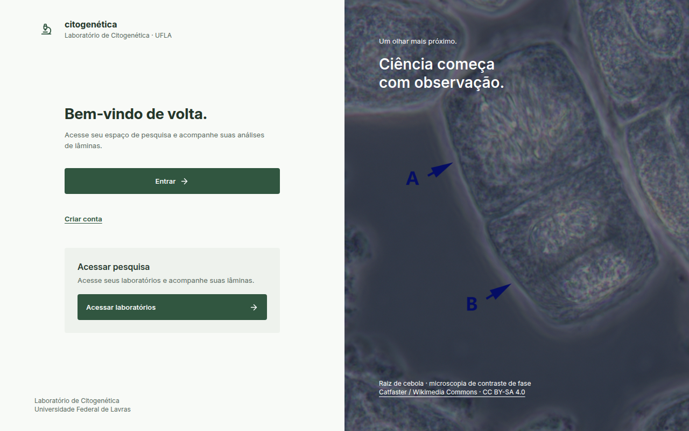

### 2. Criar conta, confirmar e-mail, primeiro acesso
- **Quer:** ter uma conta e começar.
- **Caminho:** 3 telas: formulário, "Confira seu e-mail", "E-mail confirmado". Depois, login manual. Ao todo 4 campos, 1 clique no e-mail, 2 campos de novo.
- **Problemas:** "Se houver uma confirmação de cadastro pendente para esse endereço…" soa como dúvida logo após a pessoa se cadastrar. A frase vaga protege contra descobrir quem tem conta, mas pode ser mais clara sem perder isso.
- **Proposta:** "Enviamos um link para o e-mail informado. Se não chegar em alguns minutos, confira o spam ou reenvie."
- **Tamanho:** P. Sem regra.
- 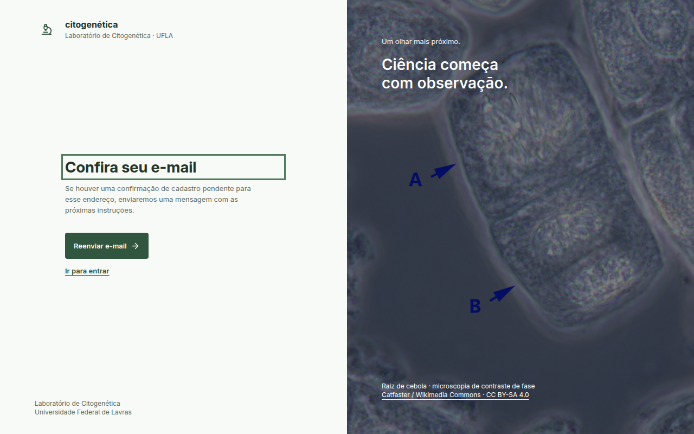

### 3. Entrar
- **Quer:** entrar e voltar para onde estava.
- **Caminho:** 2 campos, 1 clique. Volta à página pretendida: testado com `/perfil`, funciona.
- **Problemas:** o login leva a `/app` e a marca aponta para `/laboratorios`, dois endereços para a mesma tela. Quem já está logado e abre `/entrar` vê o formulário de novo.
- **Proposta:** um endereço só; quem está logado sai direto de `/entrar`.
- **Tamanho:** P. Sem regra.

### 4. Recuperar senha
- **Quer:** voltar a entrar.
- **Caminho:** 3 etapas: e-mail, código de 6 dígitos, nova senha. Depois, login.
- **Problemas:** funciona. Sobram "Limpar e começar de novo" e "Recomeçar" ao lado de "Voltar".
- **Proposta:** está bom; tirar o botão que sobra.
- **Tamanho:** P. Sem regra.
- 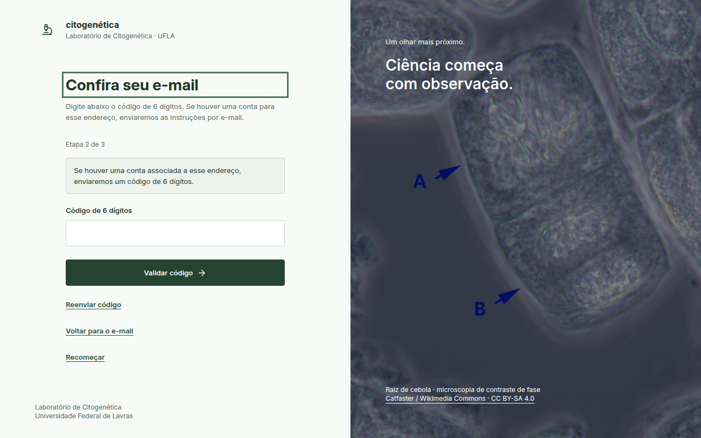

### 5. Minha conta
- **Quer:** mudar nome, senha, e-mail, foto e aparência.
- **Caminho:** menu da conta → "Configurações do perfil" → abas "Dados pessoais" e "Segurança". Modo escuro fica no menu, não aqui.
- **Problemas:** o erro "senha atual incorreta" continua na tela depois que outro formulário da mesma aba dá certo. Modo escuro deixa textos ilegíveis (ver fluxo 19). Trocar o e-mail funciona, e no fim pede novo login.
- **Proposta:** limpar a mensagem de um formulário ao usar o outro; corrigir o modo escuro.
- **Tamanho:** P. Sem regra.
- 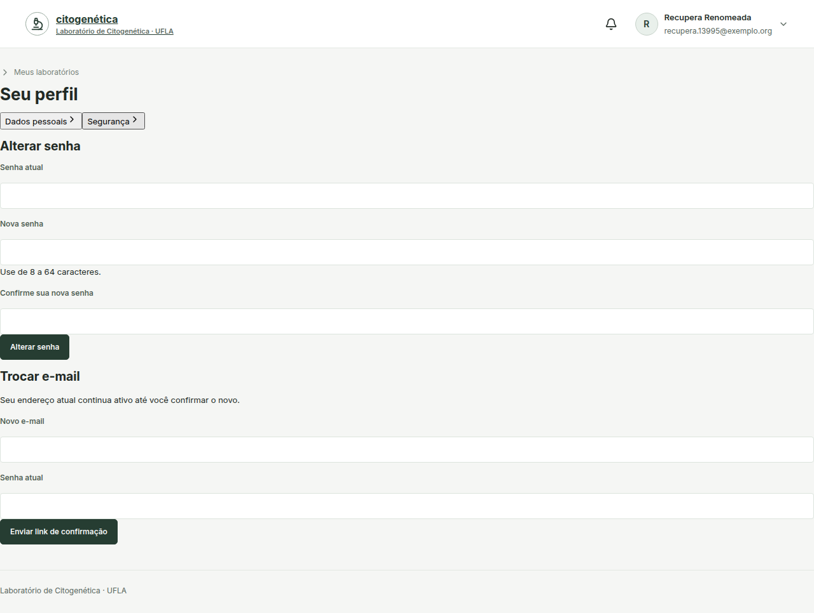

### 6. Menu da conta e sair
- **Quer:** acessar a conta ou sair.
- **Caminho:** 2 cliques. Sair leva ao login.
- **Problemas:** nenhum.
- **Proposta:** está bom.

### 7. Sessão expirada no meio do trabalho
- **Quer:** continuar o que estava fazendo.
- **Caminho:** na próxima ação, a pessoa cai na tela de login.
- **Problemas:** nenhuma explicação aparece, e o que estava digitado se perde (testado criando laboratório).
- **Proposta:** dizer "Sua sessão terminou. Entre de novo para continuar." Depois do item 2, a volta passa a ser para a mesma tela.
- **Tamanho:** P. Sem regra.

### 8. Página não encontrada e sem permissão
- **Quer:** saber o que houve e voltar.
- **Caminho:** 1 botão.
- **Problemas:** na página não encontrada, "Voltar à página inicial" leva quem está logado à tela de "Entrar".
- **Proposta:** corrigido junto com o fluxo 1. "Sem permissão" está bom.
- **Tamanho:** P. Sem regra.

## Laboratórios

### 9. Primeira tela depois do login
- **Quer:** continuar a pesquisa.
- **Caminho:** cai em "Meus laboratórios".
- **Problemas:** sem laboratório, "Escolha onde você vai continuar" não tem o que escolher. A única saída mostrada é criar laboratório, mas muita gente vai entrar por convite. O cartão destaca "Gerenciar", e o que se faz todo dia é abrir lâminas. Há dois "Abrir lâminas" iguais na tela.
- **Proposta:** texto para quem espera convite; clique no cartão abre as lâminas; "Gerenciar" fica menor; o segundo botão vira "Abrir lâminas avulsas".
- **Tamanho:** P. Sem regra.
- 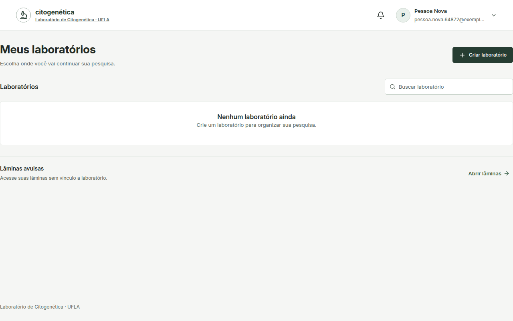
- 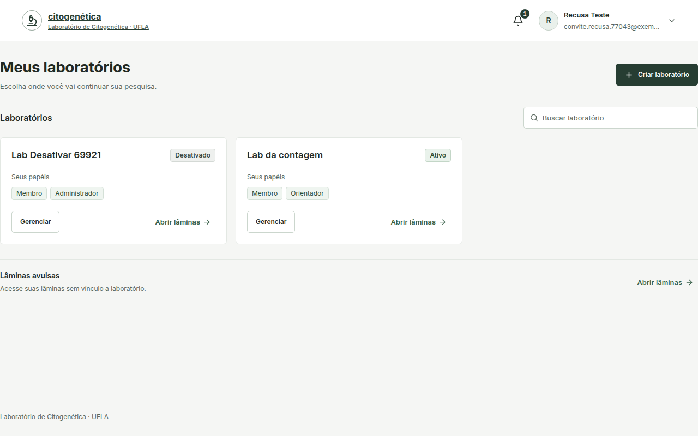

### 10. Criar laboratório
- **Quer:** criar um espaço para o grupo.
- **Caminho:** 1 botão, 1 campo, 1 confirmação. Cai em "Gerenciar".
- **Problemas:** nenhum relevante.
- **Proposta:** está bom.

### 11. Gerenciar
- **Quer:** cuidar do nome, dos membros e dos papéis.
- **Caminho:** cartão → "Gerenciar" → abas.
- **Problemas:** recarregar a página volta para "Meus laboratórios", e o botão Voltar sai da tela (confirmado). Tirar o papel de orientador de quem tem orientando é bloqueado, mas remover a mesma pessoa do laboratório é permitido. O erro anterior continua aparecendo dentro da janela de remover.
- **Proposta:** endereço próprio (item 2); limpar o erro; o dono decide como remover alguém com orientando ativo.
- **Tamanho:** G no endereço, P no erro. **Regra** na remoção.
- 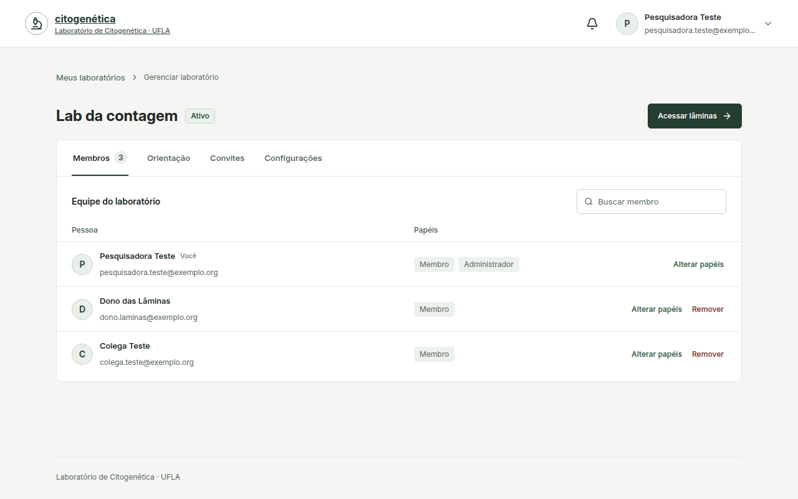

### 12. Sair do laboratório
- **Quer:** deixar o grupo.
- **Caminho:** "Gerenciar" → "Configurações" → "Sair" → confirmar. 4 cliques.
- **Problemas:** a confirmação não diz que os dados ficam no laboratório e que a pessoa perde o acesso a eles, como foi decidido. No último admin, a mensagem começa com "A operação não pode ser concluída", e a explicação útil vem depois.
- **Proposta:** dizer o que acontece com as lâminas; começar pela explicação.
- **Tamanho:** P. Sem regra.

### 13. Convites
- **Quer:** trazer alguém e responder ao convite.
- **Caminho:** admin: "Gerenciar" → "Convites" → e-mail e papéis → "Convidar". Reenviar e cancelar funcionam, e reenviar invalida o link antigo. Quem recebe: link → entrar ou criar conta → aceitar.
- **Problemas:**
  - A tela diz só "Aceite ou recuse o convite recebido por e-mail": não mostra laboratório nem quem convidou.
  - Quem cria conta perde o convite e precisa reabrir o e-mail depois de confirmar. A tela pede isso em um parágrafo difícil. Quem já tem conta e clica em "Entrar" volta ao convite normalmente.
  - Com o e-mail errado, a pessoa só descobre depois de aceitar. A mensagem junta três motivos possíveis e não há botão para trocar de conta.
  - "Convite indisponível" e "Convite recusado" não têm botão para continuar.
  - "Conta autenticada" é termo técnico.
- **Proposta:** mostrar laboratório, quem convidou e o e-mail convidado; manter o convite durante o cadastro; botão "Entrar com outra conta"; botão para seguir; trocar por "Você entrou como…".
- **Tamanho:** M. **Regra:** mostrar o laboratório antes do login, a quem tem o link. O e-mail já mostra o nome.
- 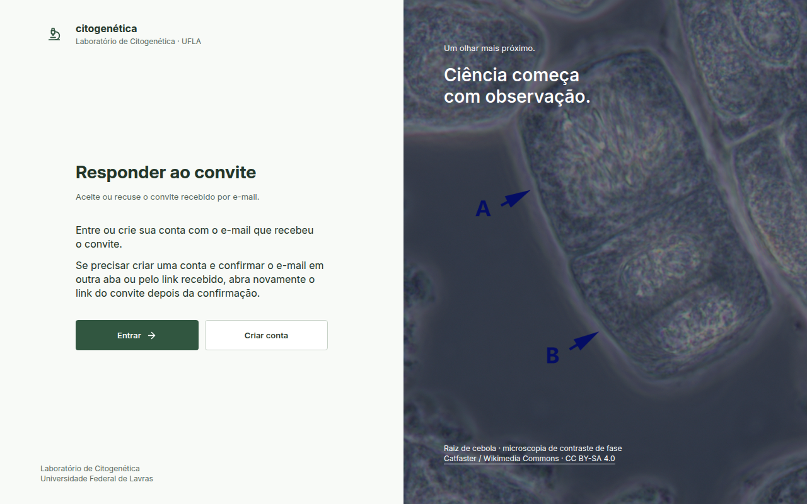
- 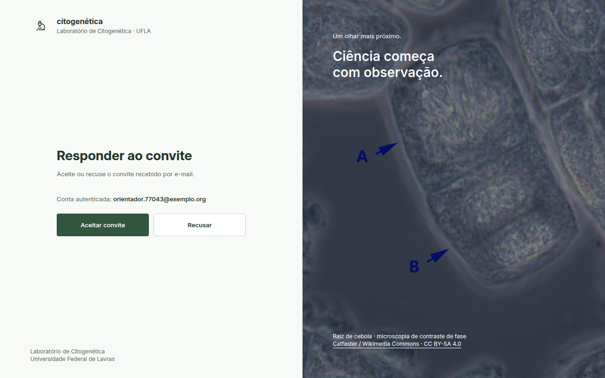
- 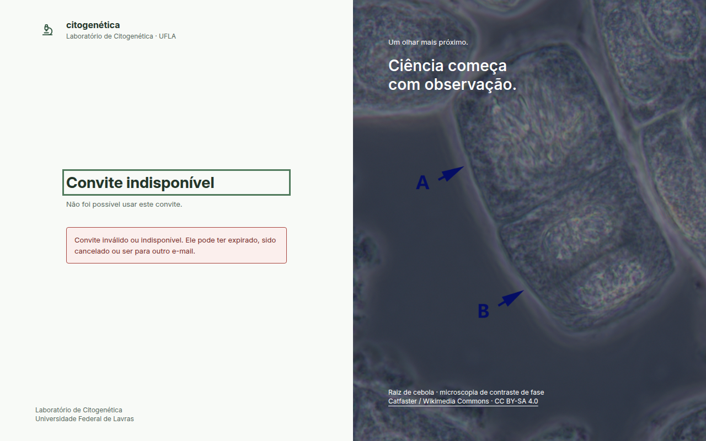

### 14. Orientação
- **Quer:** criar e encerrar o vínculo de orientação.
- **Caminho:** orientador: "Gerenciar" → "Orientação" → e-mail → convidar. Coorientação funciona, e os dois aparecem na lista. Encerrar: 2 cliques.
- **Problemas:** a tela de resposta não diz quem vai orientar ("orientado por esta pessoa"). Os demais problemas são os do fluxo 13.
- **Proposta:** mesma correção do fluxo 13, com o nome do orientador. O resto está bom.
- **Tamanho:** M, junto com o 13.
- 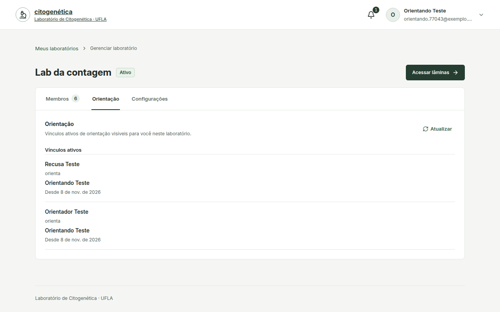

### 15. Laboratório desativado
- **Quer:** consultar os dados, sem alterar.
- **Caminho:** o cartão mostra "Desativado"; as ações de alteração somem para admin e membro, e as lâminas abrem só para leitura.
- **Problemas:** o cartão não explica o que significa nem a quem recorrer.
- **Proposta:** uma frase no cartão: "Somente consulta. Fale com a administração da plataforma."
- **Tamanho:** P. Sem regra.

### 16. Notificações
- **Quer:** saber o que chegou.
- **Caminho:** sino → lista → marcar como lida. Atualiza sozinho, sem recarregar (testado).
- **Problemas:** o aviso de convite só diz "use o link recebido por e-mail", sem como aceitar dali.
- **Proposta:** botão para responder ao convite direto pelo sino.
- **Tamanho:** M. **Regra:** aceitar sem o link do e-mail muda o desenho atual.
- 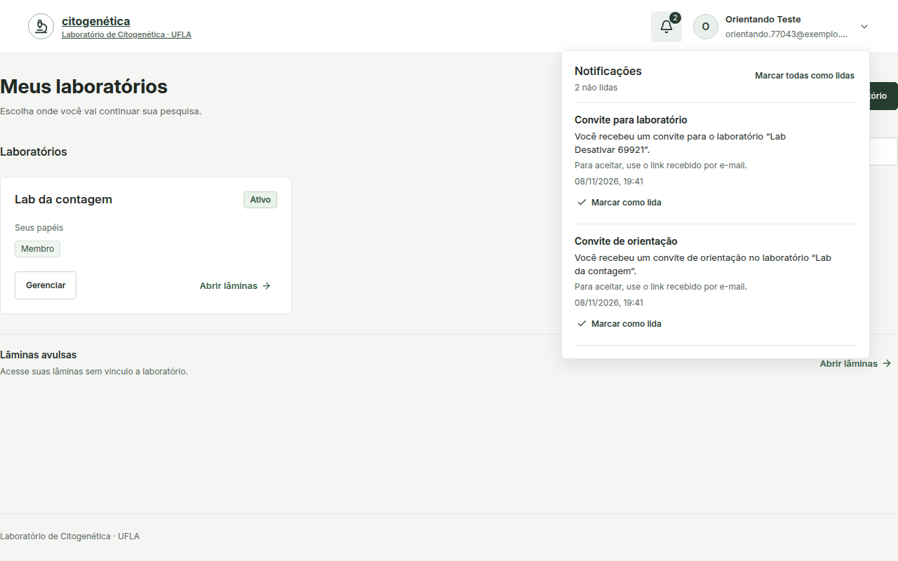

## Lâminas e contagem

### 17. Encontrar as lâminas
- **Quer:** achar a lâmina.
- **Caminho:** "Meus laboratórios" → "Abrir lâminas" → lista. A busca vale para nome, espécie e tratamento.
- **Problemas:** a lista não tem endereço próprio. "Lâminas avulsas" é termo do sistema, e nada explica a diferença na hora de criar.
- **Proposta:** item 2; subtítulo "Lâminas que não pertencem a nenhum laboratório".
- **Tamanho:** G no endereço, P no texto. Sem regra.

### 18. Criar, editar e excluir lâmina
- **Quer:** cadastrar e cuidar da lâmina.
- **Caminho:** "Nova lâmina" → formulário → cai direto na contagem. Só o nome é obrigatório, e a meta de mitose já vem em 1000. Excluir pede confirmação e informa quantas células serão apagadas.
- **Problemas:** nenhum relevante. O botão de excluir tem só o ícone.
- **Proposta:** está bom.

### 19. Contar ao microscópio
- **Quer:** registrar cada célula sem tirar o olho do microscópio mais do que o necessário.
- **Caminho:** normal: 1 clique. Anormal: botão → marcar → "Registrar célula" = 3 cliques; "Outro": 4 cliques e digitar.
- **Problemas:**
  - Em 1280×800 a lista de fases começa a 611 px do topo: só Interfase aparece inteira antes de rolar. Na meiose, com mais fases, é pior.
  - Anormal abre janela mesmo com um único tipo a marcar, e esse é o caso mais comum.
  - Não existe atalho de teclado.
  - O número fica afastado do nome da fase em telas largas.
- **Proposta:** resumo compacto e fixo no topo; na janela, um toque na anormalidade já registra, com opção "marcar várias"; atalhos de teclado depois, se o laboratório pedir. Vale testar com quem conta de verdade.
- **Tamanho:** M. Sem regra: célula com várias anormalidades continua existindo.
- 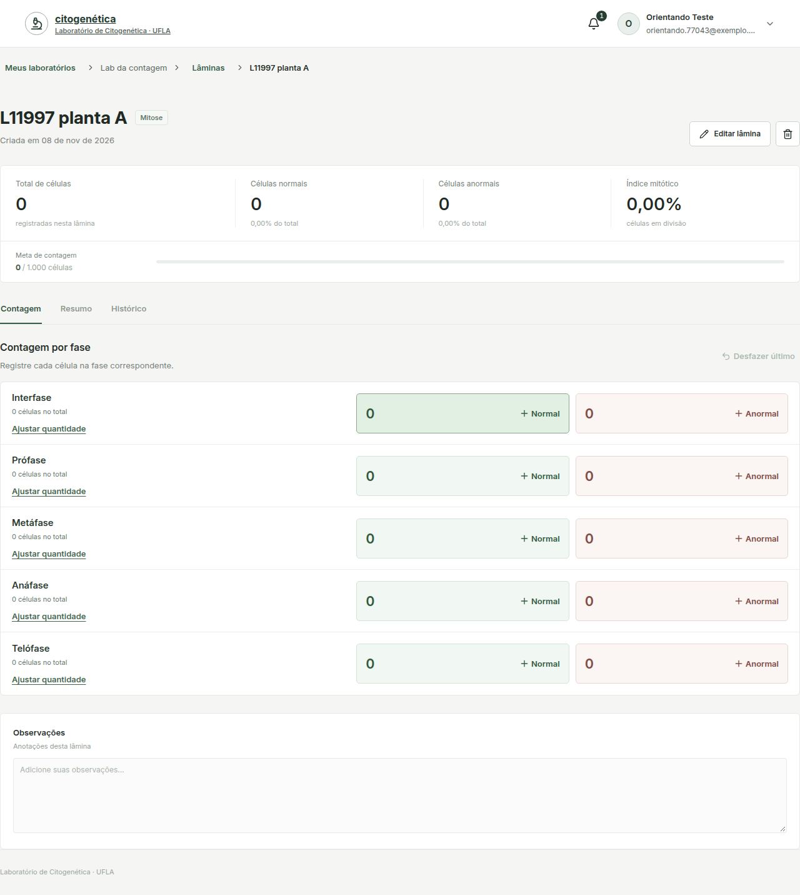
- 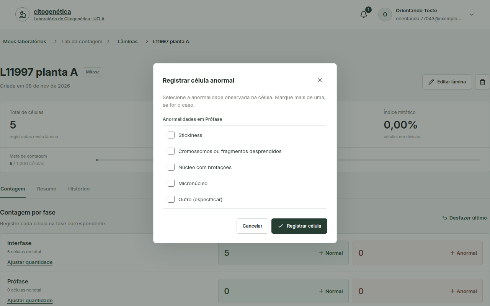
- 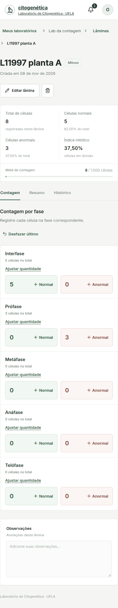
- 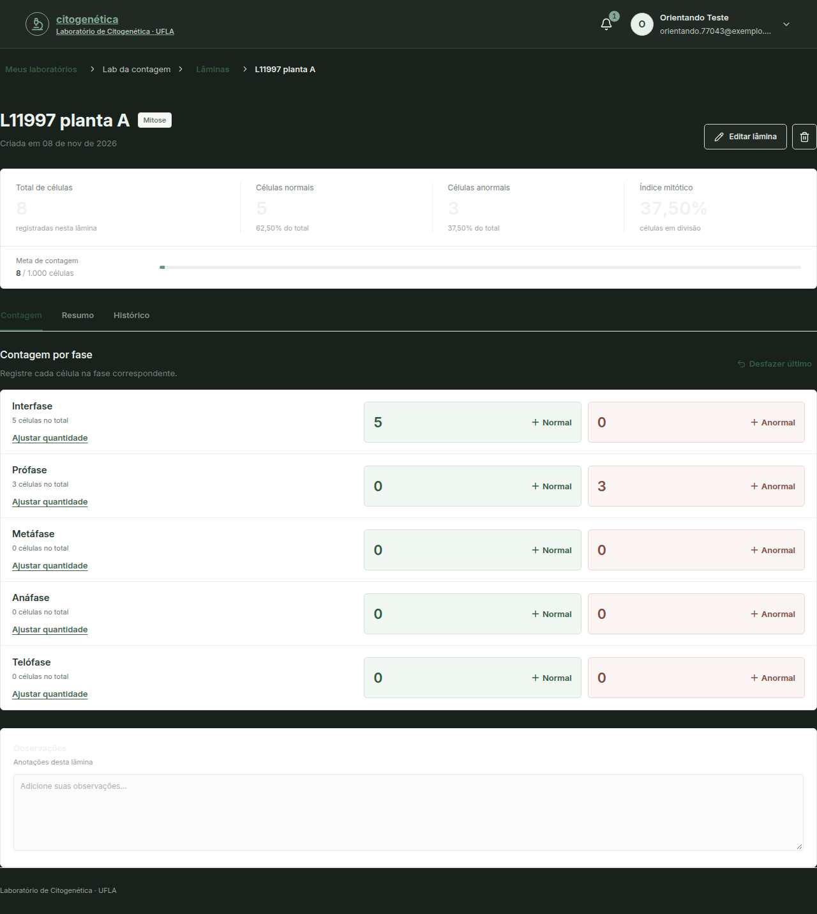

### 20. Ajustar quantidade
- **Quer:** lançar ou corrigir várias células.
- **Caminho:** "Ajustar quantidade" → adicionar/remover → normal/anormal → número → confirmar.
- **Problemas:** adicionar e remover ficam juntos, e o link se repete em cada fase. Ao remover anormais é preciso marcar exatamente o mesmo conjunto de tipos. Marcando só um deles, a resposta foi "foram pedidas 1 e há 0 nessa fase, situação e combinação de tipos".
- **Proposta:** ao remover anormais, listar as combinações que existem, com a quantidade de cada uma, para a pessoa escolher.
- **Tamanho:** M. Sem regra.
- 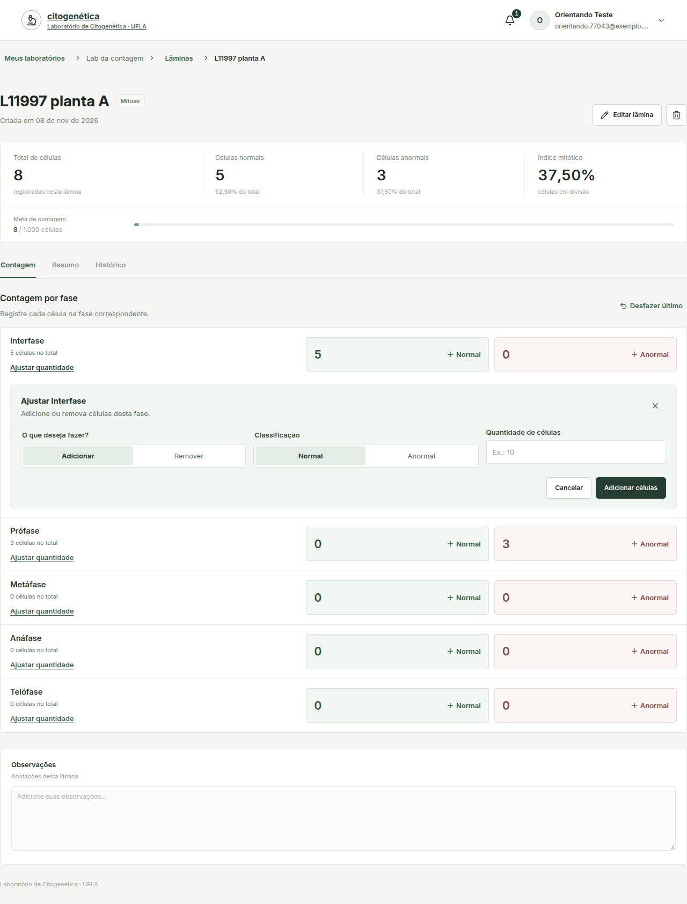

### 21. Desfazer último
- **Quer:** corrigir um clique errado.
- **Caminho:** 1 clique.
- **Problemas:** depois de um lote de 10, um clique apagou os 10, sem aviso e sem dizer o que foi desfeito.
- **Proposta:** o botão mostra o que vai desfazer ("Desfazer: 10 normais em Interfase") e pede confirmação em lote.
- **Tamanho:** P. Sem regra.

### 22. Resumo, CSV, imprimir
- **Quer:** ver e levar os resultados.
- **Caminho:** aba "Resumo" → "Exportar CSV" ou "Imprimir / PDF".
- **Problemas:** o CSV abre com as colunas certas. Na mesma célula do CSV ficam vários tipos juntos, o que dificulta o uso em planilha. Com várias anormalidades, os percentuais dos tipos somam mais de 100%, sem explicação.
- **Proposta:** decidir o formato com o laboratório na Etapa 3, como já previsto; uma nota sobre os percentuais.
- **Tamanho:** P. **Regra:** formato do CSV, pendente na Etapa 3.
- **Limite do teste:** vi o layout de impressão, não uma impressão real.
- 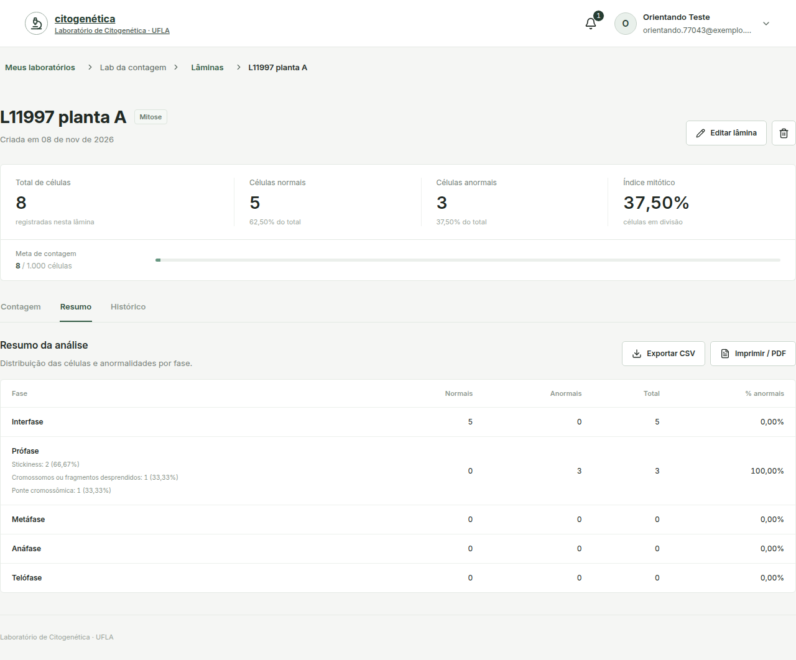

### 23. Histórico e correção
- **Quer:** achar e corrigir um registro.
- **Caminho:** aba "Histórico" → "Editar" → salvar.
- **Problemas:** nenhum relevante.
- **Proposta:** está bom.

### 24. Observações
- **Quer:** anotar algo sobre a lâmina.
- **Caminho:** digitar → "Salvar observações".
- **Problemas:** saindo da lâmina sem salvar, o texto some sem aviso (testado).
- **Proposta:** salvar sozinho enquanto a pessoa digita.
- **Tamanho:** P. Sem regra.

### 25. O que orientador e admin veem
- **Quer:** acompanhar sem alterar.
- **Caminho:** mesma lista; a lâmina abre só para leitura, com aviso de quem é. O colega comum não vê a lâmina do outro (testado), como decidido.
- **Problemas:** nenhum relevante.
- **Proposta:** está bom.
- 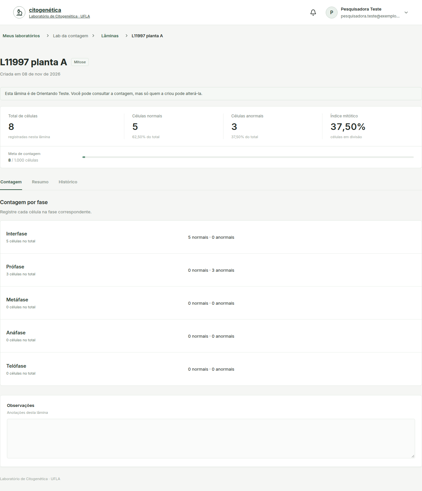

### 26. Sem internet no meio da contagem
- **Quer:** não perder o que contou.
- **Caminho:** sem caminho: a tela depende da internet até a Etapa 4, por decisão do dono.
- **Problemas:** 3 cliques sem conexão não contaram nada, e o total ficou igual ao voltar a internet. Só aparece uma faixa no topo da página, que fica fora da vista de quem rolou até as fases e olha pelo microscópio.
- **Proposta:** até a Etapa 4, guardar os cliques não enviados e reenviar sozinho, com aviso fixo que não dependa de rolagem. Se preferir não antecipar, ao menos o aviso fixo e o bloqueio dos botões.
- **Tamanho:** M. **Regra:** antecipa parte da Etapa 4.
- 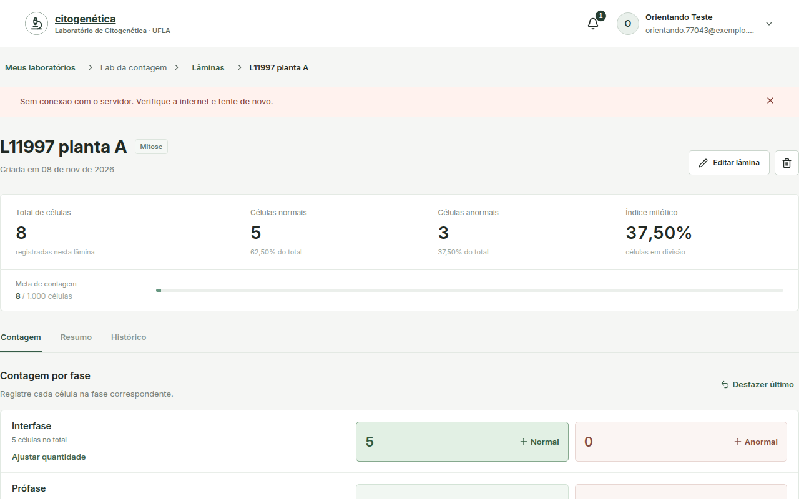

### 27. Lâminas guardadas no navegador
- **Quer:** garantir que as lâminas antigas não se percam.
- **Caminho:** abrir o laboratório certo ou as avulsas → "Baixar backup" → salvar o arquivo → "Enviar para o servidor". Repetir em cada lugar onde houver lâmina.
- **Problemas:**
  - "Meus laboratórios" não avisa que existem lâminas no navegador.
  - Só aparece no lugar a que a lâmina pertence. Testei 3 lâminas: precisaria abrir cada lugar para achar.
  - A lâmina de laboratório do qual a pessoa saiu não aparece em lugar nenhum.
  - A lâmina aparece só com o nome ("1") e as células, sem data nem protocolo.
  - O texto usa "backup" e "servidor"; os três botões têm o mesmo peso; o principal fica desativado; "Importar backup" aparece para quem nunca fez backup.
  - **Data perdida:** uma lâmina criada 30 dias antes ficou com a data do envio em "Criada em". As células mantêm a data original.
- **O que está bom:** a lâmina só saiu do navegador depois da confirmação de todas as células, e as demais continuaram lá (testado).
- **Proposta:** aviso único em "Meus laboratórios": "Você tem 3 lâminas salvas só neste computador", com nome, data, protocolo e células, e um botão "Guardar no sistema". A segurança continua sendo a confirmação célula a célula. Baixar uma cópia vira opção discreta, e importar fica escondido até ser necessário. Lâmina de laboratório do qual a pessoa saiu vira avulsa. Enviar a data original.
- **Tamanho:** M. **Regra:** tirar a obrigação do backup (decisão anterior do dono) e o destino da lâmina de laboratório antigo.
- 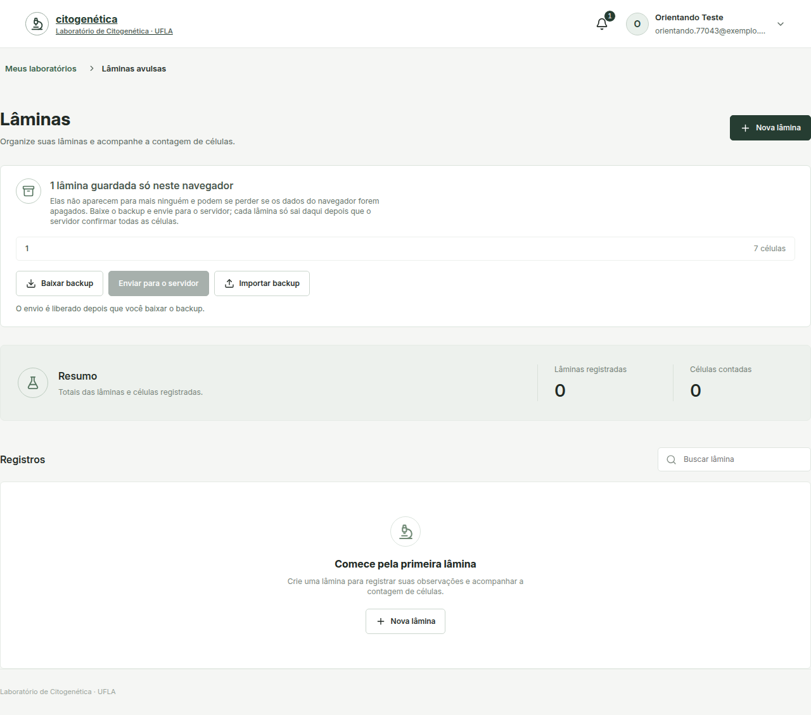

## Administração

### 28. Virar admin geral
- **Quer:** ter o primeiro administrador.
- **Caminho:** comando no terminal, uma vez por banco.
- **Problemas:** nenhum para o uso atual. Só quem instala o sistema faz isso.
- **Proposta:** está bom. Este fluxo foi avaliado pela documentação, sem rodar o comando, porque o banco já tem admin.

### 29. Painel do admin geral
- **Quer:** ver e desativar laboratórios.
- **Caminho:** menu da conta → "Administração da plataforma" → buscar ou filtrar → "Desativar" → confirmar.
- **Problemas:** cabeçalho diferente do resto, sem sino, modo escuro ou menu. O conteúdo encosta nas bordas.
- **Proposta:** usar o mesmo cabeçalho.
- **Tamanho:** P. Sem regra.
- 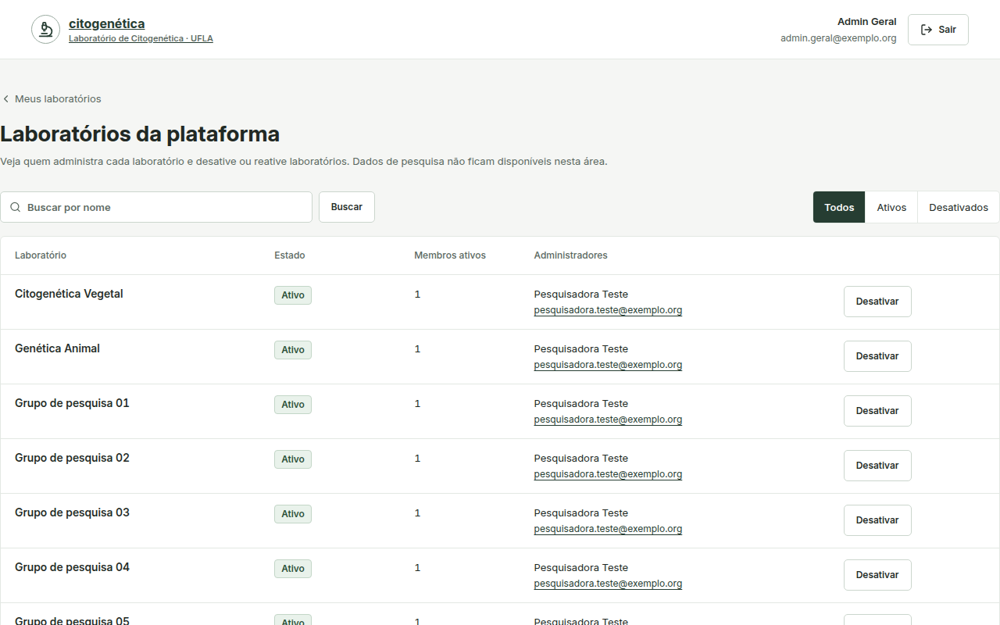

## Visual, em todas as telas logadas

- O conteúdo encosta nas bordas no computador: a classe `.container` perde a margem, provavelmente por conflito com a do Tailwind. A tela de "Gerenciar" não tem o problema.
- A marca "citogenética" aparece sublinhada.
- Modo escuro: resumo e título de Observações ficam quase invisíveis, porque os painéis continuam brancos; "Meus laboratórios", "Lâminas" e "Desfazer último" ficam com pouco contraste.

## Fora do escopo, anotado

- `tests/*.test.ts` (3 arquivos) não rodam em nenhum comando de teste, anotação já existente.
- O contador da aba "Membros" não atualiza até recarregar, quando alguém aceita um convite.

## Dados de teste criados no banco local

Contas `pessoa.nova.*`, `orientador.*`, `orientando.*`, `convite.recusa.*`, `recupera.*`/`trocado.*`, o laboratório "Lab Desativar 69921" e lâminas "L… planta A" e "1" no "Lab da contagem" e nas avulsas de `orientando.*`. Todas as contas com senha `Outra#Senha2026`, exceto a de recuperação, que foi trocada no teste.
